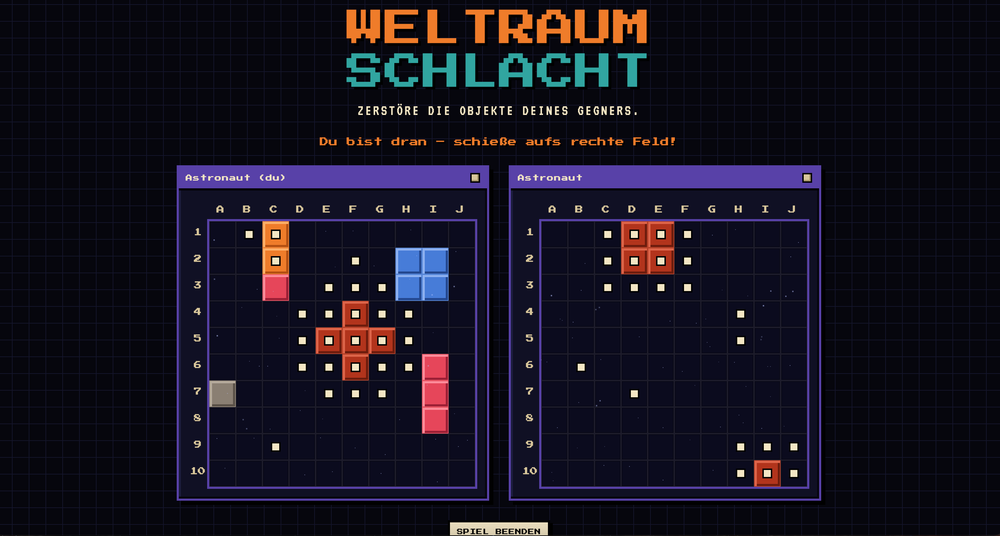

# Schiffe versenken / Weltraum-Schlacht



**Live ausprobieren:** https://schiffe-versenken-z71e.onrender.com

Online-Multiplayer im Browser (Node.js + WebSockets, Frontend ohne Build-Tools).
Auf der Startseite wählt man mit dem großen Schalter links oben die Version:

- **Klassisch** – Schiffe in geraden Reihen
- **Weltraum** – Objekte mit Formen: Asteroid (1 Feld), Raumschiff (3 in einer Reihe), Planet (2×2), Stern (Kreuz aus 5 Feldern)

## Starten
```
npm install
npm start
```
Dann `http://localhost:3000` öffnen. Spiel erstellen, den Link an den Mitspieler schicken.
Im selben WLAN: `http://<IP-des-Mac>:3000`.

## Logbuch
Jede zu Ende gespielte Partie wird gespeichert: Namen, Geräte-ID (pro Browser), Datum/Uhrzeit, Variante, Gewinner, beide Aufstellungen und alle Schüsse in Reihenfolge.
Das Logbuch ist nicht verlinkt, sondern nur über `/logbuch` erreichbar (z. B. `http://localhost:3000/logbuch`). Dort lassen sich alte Partien ansehen – mit Endstand beider Felder und Zug-für-Zug-Wiedergabe –, nachträglich Aliasse für die Spieler und ein Kommentar vergeben sowie Partien einzeln oder komplett löschen.
Direktlink zu einer Partie: `/logbuch?partie=<id>`.

**Speicherort** (SQLite, Tabelle `games`):
- Online/dauerhaft bei [Turso](https://turso.tech): Umgebungsvariablen `TURSO_DATABASE_URL` (`libsql://…`) und `TURSO_AUTH_TOKEN` setzen (auf Render unter *Environment*).
- Ohne diese Variablen lokal in `data/logbook.db` (anderer Ort: `LOGBOOK_DB=file:/pfad/zur/datei.db`). Auf Render (kostenlos) wäre die lokale Datei nach Neustart/Deploy weg – dort also Turso verwenden.
- Eine ältere `data/logbook.json` wird beim ersten Start einmalig übernommen und in `logbook.json.importiert` umbenannt.

**Passwort:** Das Logbuch ist passwortgeschützt (Browser fragt nach Benutzer + Passwort, Benutzername egal). Das Passwort steht **nicht** im Repo, sondern in `data/logbook-password.txt` (von Git ignoriert) oder in der Umgebungsvariable `LOGBOOK_PASSWORD`. Ist keins gesetzt, bleibt das Logbuch gesperrt.

## Tests
```
npm test
```

## Regeln
Spielfeld beim Erstellen wählbar. Objekte dürfen sich nie berühren (auch nicht diagonal).
Asteroiden brauchen zu jedem anderen Objekt mindestens zwei freie Felder Abstand.

| Variante | Feld | Klassisch | Weltraum |
|---|---|---|---|
| Mini | 5×5 | 3, 2, 2 | Raumschiff, 2 Asteroiden |
| Normal | 10×10 | 5, 4, 3, 3, 2 | Stern, Planet, 2 Raumschiffe, Asteroid |
| Groß – Schwer | 15×15 | 5, 5, 4, 4, 3, 3, 3, 2, 2, 2 | 2 Sterne, 2 Planeten, 3 Raumschiffe, 3 Asteroiden |
| Groß – Experte | 15×15 | 5, 4, 3, 3, 2 | wie Normal |

Nach einem Treffer darf man nochmal schießen (`EXTRA_SHOT_ON_HIT` in `shared/rules.js`).
Varianten und Objekte stehen in `MODES` und `THEMES` in `shared/rules.js`.
Der Asteroiden-Abstand steht in `ASTEROID_GAP` (2 = zwei freie Felder, 1 = nur nicht berühren).
